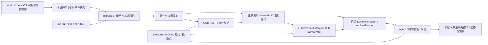

# Mote 架构

账号隔离、配置发布和后台工作寿命的统一合同见[统一架构与用户旅程 ADR](adr-unified-user-journeys.md)。该决定以一致的用户体验为目标；本轮实现、验证及发布进度分别记录在[实施记录](validation/unified-user-journeys-2026-10-23.md)。

生产入口 `apps/server/src/app.ts` 导出账号作用域的 `buildScopedApp`，单账号也走同一路径。实例共享 SQLite、执行器和运行资源，私人数据与配置按服务端认证账号隔离；旧单所有者组合只由 `test/fixtures/legacy-app.ts` 显式提供算法回归，不能打开 epoch 5。业务流程及音频备份不自动 ASR 的决定见[共用业务流程 ADR](adr-shared-business-flows.md)。[10 月 18 日审计](audits/business-flow-parity-2026-10-18.md)保留当时缺口，不能代替后续实现和验证状态；后继对账见[项目推进审阅](audits/project-map-and-progress-review-2026-10-20.md)。

任务期限与失败恢复的目标原则见 [2026-10-15 ADR](adr-task-recovery-and-execution-budgets.md)：每种任务在开发和注册时声明自身的宽松默认超时策略，不统一套用 600 秒；资源等待、模型反馈修正、实际失败和结果未知分别处理。中央注册策略与具体默认值见[任务执行策略](task-execution-policies.md)；部署与验证范围单独记录。

问答覆盖、无字符近似配额的正常分页、录音语料时间与规范正文，以及质量对照和实际恢复边界，以[2026-10-14简化决定](adr-ask-evidence-quality-and-simple-context.md)为准。Memory不再自动二分恢复，历史验证与已固定记录仍保留各自日期和身份。

Mote 是 AI-native 的个人上下文采集器与中央归档。当前生产基线为 Central epoch 5、Desktop / Android 本机格式 4、Wire 2、Ingress 3、个人便携归档 version 3，各自独立于产品版本。旧库、旧 owner token 和旧协议不迁移或双写，见[多用户决定](adr-multiuser-scope.md)、[主线集成](adr-multiuser-main-integration.md)和[更新说明](updating.md)。

导入说明是确切新增原件的宿主背景，不是整份来源的身份分类。个人 v5 保留 v4 的声明、日记主叙述者、时间框架与续文解释，并组合范围评估与模型择要；真实身份未知时仍保留有限观察。新 Memory 任务区分产出目标与同一任务的已授权解释范围，提取和独立审核模型可按具体缺口补读原件。实际披露范围提供精确引用资格并保留阶段依赖；未读许可不成为本批上下文依赖，另一未读原件的变化不撤出独立目标。Ask 逐事实核对主体和时间。版本与旧任务边界见[上下文读取 ADR](adr-memory-context-reading.md)，v3 固定定义见[有限个人 Memory ADR](adr-bounded-personal-memory.md)。

新的 `range-evaluation@1` 配方及新建的未指定配方独立审核任务保留完整原件，逐授权范围评估并独立审核，由模型选取有用 Memory；完成不承诺列出全部有用事实。未读、截断或未完成评估的范围保持未完成。显式旧配方/收据仍保留固定身份和输出合同，但宿主对所有任务取消自动二分；实际容量失败保留原范围，明确临时传输故障复用共享执行器的有界重试。见[范围评估 ADR](adr-memory-range-evaluation.md)与[简化决定](adr-ask-evidence-quality-and-simple-context.md)。

Android 文件任务另有选填来源说明：所有者原文以私有版本化元信息保存，当前版本作用于已有和未来资料，单份归属纠正保留。模型通过只读来源目录与上下文读取说明，语义产物和对话记录实际读取的版本；修改会撤出旧当前结论并拒绝迟到提交，原件及 ASR/OCR 保留，历史收费处理由用户明确重试。它与 Web 导入批次的冻结说明范围不同，见[文件任务与来源说明 ADR](adr-file-source-context.md)。

中央操作员选定的实例 YAML 与每账号私人 YAML 分别使用 ConfigService；各自的网页/文件编辑共用校验、revision、准备和应用事务，共享资源引用不复制共享秘密。业务数据库、不可变 Memory 策略与历史授权、任务配置快照、设备本地隐私仍属于各领域。热更新与需重启/迁移字段明确区分，见 [统一配置 ADR](adr-unified-configuration.md) 和 [配置归属](configuration-ownership.md)。

## 代码目录与责任

| 目录 | 当前责任 |
| --- | --- |
| `apps/server` | Fastify Central、来源接入、存储、Material、处理与执行器、委派、Memory、权限和查询 |
| `apps/web` | Central 网页；随 server 发布，展示资料、问答、活动、设置与处理状态 |
| `apps/desktop` | Electron macOS 采集器、Swift 原生助手、本机隐私审查、持久队列及来源原件上传 |
| `apps/android` | Kotlin 平台采集、ML Kit 可选文字规则审查、本机队列、来源与同步 |
| `packages/shared` | TypeScript 数据/协议契约、国际化、发布验证及公共工具 |
| `packages/agent` | DeepSeek Harness / Codex 适配、只读工具桥、上下文装配和运行时 Skills |
| `packages/diagnostics` | 有界数值诊断、固定事件与支持包 |
| `protocol` | 跨平台 wire 契约和共享生成 fixture |
| `plugins`、`adapters`、`examples` | 已有宿主契约上的来源、UI 与连接器扩展示例 |
| `scripts`、`deploy`、`.github`、`release` | 合成验证、环境/备份/构建、部署与组件发布 |
| `docs`、`licenses` | 当前指南、ADR、带日期的验证证据和依赖许可证 |

退役的 `packages/local-inference`、`models` 与端侧 Qwen 启动/下载工具已删除。中央 OCR/ASR 模型由 `media-assets.ts` 与 Worker 安装流程管理，不依赖端侧 Qwen。

## 接入、原件与正式资料

客户端独立采集，Central 不远程开启屏幕采集。应用规则、遮罩和用户指定的文字隐私规则在本机处理；只有开启文字审查且规则非空时调用本机 OCR。Central 模型不参与接入授权。来源适配器提供协议身份、原文、可靠时间和稳定版本，不用语义关键词推断主题或用户意图。

Ingress 3 在当前账号与来源事务中保存原件/版本，返回固定部署、账号、来源、批次和成员的回执，确认只证明输入已接收。来源适配器、处理器和 Coding preparation 分别拥有其规范表示、fidelity 和发布规则；接收成功、Material 发布、理解与 Memory 完成是独立状态。当前路由见[协议](protocol.md)，Coding 的语义与产物合同见[编码记忆](coding-agent-memory.md)。

`capturedAt` 是观察时间，`receivedAt` 是首次接收时间，journal 游标是到达/变化顺序。文档另保留 `recordedAt / occurredAt / timeBasis`；没有可靠发生时间时不以上传日期代替。重试相同身份和字节；冲突不会覆盖原版本。

中央原件位于 `originals/<部署与账号散列>/objects/<sha256>/<part>.plain|.aes`，每片最多 4 MiB，账号引用、pin 与实际活动约束 GC。SQLite 保存账号限定的规范记录、索引和任务；共享库文件不提供跨账号读取权。个人原件加密默认关闭，启用后不等于整个 SQLite 加密。客户端格式 4 内容原样保存在私有目录，Prod 凭据用系统保护，Dev 的 Mote 自有凭据使用私有文件；详见[内容存储](content-storage.md)。

图片默认绑定中央本地 OCR 策略；图片理解是独立的模型阶段，由当前方案、授权与模型可用性控制。Agent 读取原图另受披露开关与范围约束。音频默认本地 ASR 与匿名说话人分离；模型和 Worker 未就绪时保留原件并等待。文件快照索引单独保存，处理结果不改写接入时的原始回执。

截图和 Android v2 页面字段的自动 Memory 凭据由统一采集接收入口在原件事务中登记。
页面沿用独立的原文资料组织器，以就绪 `source-body` 进入现有分批提取与审核流程；
`visible_window` 部分覆盖及按需原文查询保留。详见
[页面自动 Memory](adr-ui-page-automatic-memory.md)。

截图和页面另有按原件身份组织的事件资料，以 `daily-events` 输入进入独立日常事件
提取和审核策略。事件保存为可按天检索的 observation，保留状态、说话者、采集时间
和原件证据；截图/页面默认组合与一般来源默认、具体来源覆盖分开配置。详见
[日常事件 ADR](adr-daily-event-memory.md)。

## 执行与模型边界

ExecutionEngine 负责并发、资源互斥、持久租约、输入版本、取消、超时、重试与提交 fence。当前任务中断可恢复成功检查点；删除、授权撤销和配置变化阻止晚到输出发布。没有每日调用、字符、token 或费用硬预算；实际用量和价格记录继续保留，未知用量不当作零费用。

当前 Ask、Memory、Files 等账号域在同一 M05 执行器中运行。普通问题默认直接查证，模型可通过宿主研究控制提交只读子任务；等待、重启、取消及已完成检查点保持持久身份。Memory 按固定策略、原件范围和授权执行提取、独立审核、staging 与 fenced 保存。普通停用或暂停关闭后续生产者准入，已接收的提取、审核和发布继续排空；待整合窗口冻结截止成员并保留原到期时间，同一版本按持久占用规则避免重复准入。恢复不会重新开放旧生产者回执或补做暂停期间的输入。立即停止则撤销未完成自动工作；来源撤销、隐私变更及账号失效仍阻止迟到发布。外部引擎只接管声明阶段，原件授权、独审和最终发布仍归宿主。重复 ACK、派生更新和重启不授历史工作。见[统一旅程合同](adr-unified-user-journeys.md)、[连续批次](adr-memory-continuous-batch.md)、[插件边界](adr-plugin-center-memory-replacement.md)和[系统改造决定](adr-system-refactor.md)。

查询、理解、Memory 与洞察运行时仅提供宿主授予的只读上下文工具与 Skill。原文、OCR、元数据和模型产物都是证据，不能改变权限或系统指令。引用必须指向本轮实际读取且范围允许的原始片段；派生摘要不授予未读原文的引用权限。

导入是独立运行时，可使用文件/shell 工具生成预览清单；宿主校验原件、版本、路径和用户确认后提交。日程建议的外部写入也由独立的用户授权与宿主队列处理，不向查询 Agent 开放写工具。

## 产品与运维边界

Central 不设置普通业务 HTTP 次数额度，不按前台/同步接口分配请求配额；积压任务由执行并发、取消和生命周期调度。M01 密码登录保留已批准的认证尝试保护，用户配置的存储容量和上游实际限流仍适用，见[请求准入](adr-central-request-admission.md)与[多用户认证例外](adr-multiuser-scope.md)。

Central 是单实例写入、账号私人数据隔离的多用户节点，server/web 同版本发布；Desktop 与 Android 独立发布。连接校验 Wire、Ingress 和当前凭据能力，不用产品版本猜权限。设备邀请只授自身 ingress / 获准 Actions，账号会话访问本人归档，管理员管理账号与共享资源而不通过普通 API 读取他人私有资料；MCP 另有独立 scope。

命名环境隔离配置、凭据、队列、目录与进程。默认绑定 loopback；远程部署使用 TLS、强账号密码和受保护的访问凭据。当前格式的队列位置迁移和同 epoch 备份恢复是显式功能，旧 epoch 库会保留并拒绝启动。日志和支持包只记录固定类别、数值与状态，不记录私人正文或凭据。

扩展应复用宿主来源、recipe、processor、Material 与只读证据契约。更大存储、其他硬件或新模型运行时需要各自明确设计与验证，不能从现有接口推断已经支持。

细节见 [正式资料](material-architecture.md)、[来源流水线](source-pipelines.md)、[执行器](execution-engine.md)、[委派与活动](delegation-and-activity.md)、[Memory](memory-lifecycle.md)、[部署](deployment.md) 和 [文档索引](README.md)。
