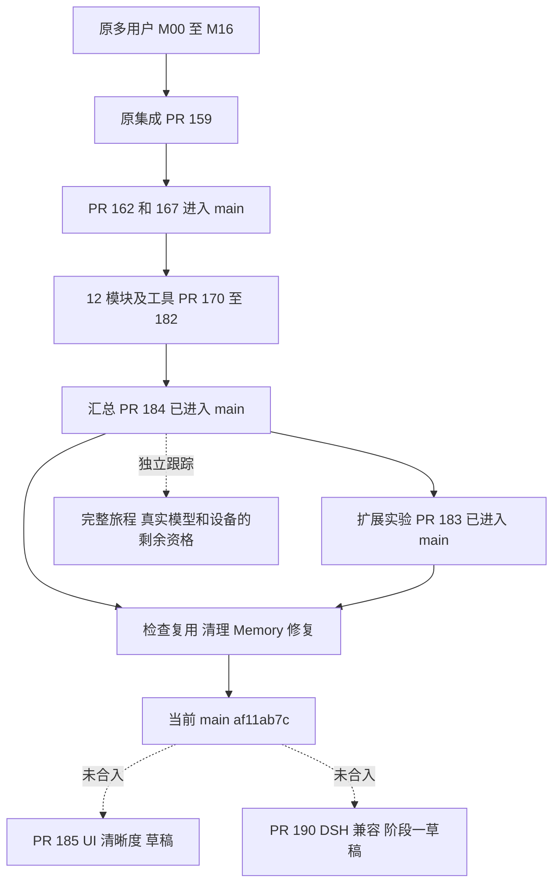

# 项目地图与事项推进进展审计

日期：2026-10-20。源码冻结于 `af11ab7c3e9fb5f38deaea4e4bae11462a7306b4`，与本轮重新 fetch 的 `origin/main` 一致。GitHub PR、Issue 和 Release 状态在北京时间 17:17 前后只读核对。本文补充[现状文档与 ADR 审计](documentation-review-2026-10-20.md)，不修改原计划、历史回执、任务状态或产品实现。

主要结论：项目地图分散在模块计划、作用域 JSON、验收矩阵、聊天和本地检查点中，缺少一个能读到今天状态的入口。源码已进入主线、检查已通过、完整用户旅程已验收、已发布、已部署经常挤在同一个“完成/未完成”字段里，造成相反的读法。不能从旧清单算当前完成率，也不能用最新功能检查的通过关闭所有历史质量和设备缺口。

补充：用户提供另一份审阅后的[交叉验证与统一修订建议](documentation-review-consolidated-2026-10-20.md) 给出 F01–F13 的当前反例、66 行主状态的准确口径，以及适合直接修文档或另查实现的边界。

## 当前交付图

以下是核对后的代码流向，表示提交关系和当前工作范围，不表示所有验收已通过：

图中表示交付归并顺序和归属，不展开所有开发分支的原始分叉点。虚线到草稿表示尚未进入当前主线；两个草稿各有冻结基线，并非从 `af11ab7c` 创建。发布包和运行中的节点也不能由这张代码图推定。

| 事项 | 可确认的当前进展 | 仍不能据此宣称 |
| --- | --- | --- |
| 原 M00–M16 多用户改造 | 原集成已通过 [PR 159](https://github.com/utopiafar/mote/pull/159)、[PR 162](https://github.com/utopiafar/mote/pull/162) 等进入主线；当前生产装配已包含各账号域 | 原 17 模块的每一条验收、所有设备和真实模型质量都通过 |
| 第二轮业务恢复 | [PR 170–182](https://github.com/utopiafar/mote/pull/184) 的 13 个模块/工具 PR 已合入集成分支；[PR 184](https://github.com/utopiafar/mote/pull/184) 于北京时间 10 月 20 日 10:34 合入 main，merge `9a8717c3` | 66 行矩阵和跨模块全部原旅程已完成资格验收 |
| 扩展实验与后续集成 | [PR 183](https://github.com/utopiafar/mote/pull/183) 已合入；后继集成报告记录 `f92fec71` 的 23/23 阶段通过 | 原五轮实验已由 0/5 变为 5/5，SQLite 损坏根因已解决，任意社区插件完整链路已打通 |
| 清理、检查器和 Memory 后续修复 | PR 168/186/187/188/189/191/192/193 均已合入。最新[功能检查记录](../validation/pr-168-189-191-integration-2026-10-20.md) L130–179 的被测源码是 `0696be48`，23 个任务新执行通过 | 这些检查在本次审计重新运行；所有旧故障的真实模型、设备、部署状态因此关闭 |
| UI 清晰度新一轮 | [PR 185](https://github.com/utopiafar/mote/pull/185) 仍 Open Draft，head `73fc85a0`；正文明确准备阶段、0/15 轮、R0 实操未运行 | 已完成 15 轮或已有产品 UI 改进交付 |
| DSH 生态兼容 | [PR 190](https://github.com/utopiafar/mote/pull/190) 仍 Open Draft，head `b3259959`；阶段 1/4，21 项离线审计测试通过，原生 smoke 预检阻塞 | 插件已实际安装/加载/调用、已进入 Mote 产品入口，或四阶段完成 |
| 发布与部署 | GitHub 仍可读到 Central 0.0.90、Desktop 0.0.88、Android 0.0.89 等较早 DEV Release；特定版本发布已另行确认，见 P9 | 这些旧标签已包含今天 main 的恢复和修复；当前节点已部署最新源码。新的 Actions artifact 不在本次完整核查范围 |

## 找到的地图和台账各自是什么

| 材料 | 实际职责 | 当前不能拿它回答什么 |
| --- | --- | --- |
| [implementation-backlog.json](../implementation-backlog.json) | 55 项需求/验收清单，带 0.0.61 总结，但混入后续替换 | 当前全项目完成率、现在只剩哪两项 |
| [scope-inventory.json](../design/scope-inventory.json) | 检查器消费的 Server 边界声明，209 个文件条目 | 所有产品能力、每个模块完成率、完整用户旅程是否通过 |
| [M00–M16 模块图](../design/multiuser-modules.md) | 初始依赖和必须满足的验收合同 | 今天是否仍只有 M00、当前哪些 PR 等待合并 |
| [恢复计划](../design/multiuser-parity-restoration-plan.md)、[边界恢复计划](../design/multiuser-parity-boundary-restoration-plan.md) | 第二轮的职责、来源、当时的派工和冻结检查点 | 当前 GitHub 的合并状态、现在真实运行的槽位、永久有效的调度授权 |
| [恢复矩阵](../validation/multiuser-parity-restoration-matrix.md) | 58 条核心加扩展合计 66 行要求，以及后续分范围证据 | 单凭主行 OPEN 判未实现；单凭某次门禁通过判 66 行全部关闭 |
| UI、插件、联合验收和 benchmark 报告 | 各自冻结候选的计划、执行结果和限制 | 一份报告的“最终”能否代表之后所有轮次的最终状态 |
| 本地 PM / driver JSON、项目聊天 | 当时的交接、运行槽位和细分来源 | 当前进程仍在运行、旧分支仍未集成、旧控制者仍有本轮派工权 |

仓库路径、标题和引用、项目主检出目录及相关项目聊天均做过定位；可访问 Pages 列表未找到另一个 Mote 地图。未定位到一个单独命名并持续维护的“项目地图”页面。上述材料是实际承载地图职责的入口，不应任意挑一份充当当前全局权威。GitHub Projects 查询因当前凭据缺少 `read:project` 未能读取；这不证明没有外部看板，本次未变更授权。

## 确认的矛盾和更新滞后

### P1 旧 55 项清单不是一个干净的历史快照，也不是当前清单

[清单](../implementation-backlog.json) L3 固定基线 `3561947`，L997–1008 仍写 reviewedVersion 0.0.61、53 verified / 2 partial；计数本身正确。但 L275–293 的 SYNC-06 已在 `dbaa3e9a`（10 月 11 日）从旧设备读请求改为 Central retained-text 读取，未同步调整总基线和其余项目。

同时，L578–595 仍把每日/Provider/Operation 硬预算列为 verified，L920–935 仍写 schema migration；这些已被后续 MVP 和吞吐决定取代。既不能把它解释为“今天已完成 53/55”，也不能据此把已移除能力重新实现。

建议：将 0.0.61 原验收固定到当时 tag/commit，另设当前替代关系；或者明确把整份清单重定基线，逐项标当前保留、取代、移除、实现和验证状态。前者改动更小，也更能保留历史。

### P2 旧清单里的证据已无法按当前路径复核

上述 JSON 有 **12 条引用、9 个不同路径**在当前树不存在，例如 `docs/model-budgets.md`、`apps/server/test/model-budgets.test.ts`、`scripts/test-web-budgets.cjs` 和旧 benchmark 脚本。静态 Git 对象核对确认 9 个路径在 `v0.0.61` 均存在。

这不是历史测试失败，而是证据链接没有固定版本。上一轮 Markdown URL 检查不覆盖这些 JSON 字符串中的证据。建议历史引用绑定原 tag/commit 或原回执；当前状态另指替代实现及其证据。不要为了恢复链接重建已经退役的代码，也不要把旧 PASS 改成 FAIL。

### P3 作用域地图的 status 无法表达事项完成度

[scope-inventory](../design/scope-inventory.json) 有 209 个条目：169 个没有 status、34 个为 implemented、1 个 partial，其余 5 个是不同阶段的自由文本。76 个 `scope/*` 条目中有 44 个缺 status。缺失不表示未实现，implemented 也不表示验收通过。

`scripts/check-scope-contracts.mjs` L49–58 校验 scope、模块和检测到的 surface，不读取 status/notes；L10–12 也明确它是变更检测器。[模块计划](../design/multiuser-modules.md) L57–60 要求登记实施状态，但该状态没有统一语义。

建议：作用域地图继续负责边界声明，事项进度使用独立台账。若仍保留 status，需定义词汇、缺失含义和证据链接。该 JSON 是检查器输入，修改须执行相应 scope/检查基础设施验证；若改变职责、授权合同或检查成功标准，再按技术方案审查流程处理，不能仅按普通文案整理。

### P4 “隔离旧宿主”被整文件标签误读为“生产完全不用”

`scope-inventory.json` L99–105、L1269–1276 把 `backend-plugin-scope.ts`、`plugin-release.ts` 标为 legacy-quarantined，但当前 `scope/plugins.ts` L15、L82、L370 实际使用其受约束的 worker/catalog 帮助类。L691–713 的 `file-processors.ts` 也有该标签，不过 note 已说明 M06 经 scoped ports 复用；`scope/processing.ts` L14、L69 确实构造该运行时。

检查器 L76–78、L91–94 明确允许这些受限复用。这是地图粒度含糊，**没有据此发现旧 owner 路由被开放或隔离失效**。建议区分旧宿主注册面与当前共享算法/注册器，并一致补充复用说明；不能按“legacy”标签直接删除活跃帮助类。

### P5 恢复计划仍写“13 个 Draft 未合并，main 未含业务”，实际已交付源码

[恢复计划](../design/multiuser-parity-restoration-plan.md) L97–109、L230–232 和[边界计划](../design/multiuser-parity-boundary-restoration-plan.md) L19–47 仍停留在旧集成分支、13 个 Draft、业务 head 尚未进入正式目标的阶段。

GitHub 现状和本地祖先核对一致：13 个 PR 已合入集成分支，随后 PR 184 合入 main；表中 13 个原 shipping head、`cd0da8d` 和管理 checkpoint `c6110e6` 均为当前 HEAD 祖先。原计划当时的“不合 main”是阶段性范围，不应当作今天的永久禁令；后来 merge 也不能反向证明所有旧验收当时已完成或原先已有合并授权。

建议新增有日期的交付后记，链接实际 merge、后续授权和剩余资格；把“源码未集成”关闭，把未完成的真实旅程留在独立列。

### P6 初始模块地图、66 行主表和后追加证据没有汇总到同一进展入口

[初始模块图](../design/multiuser-modules.md) L3–8、L43–44、L160–170 正确记录最初的规划和 M00 阶段，但没有指向已交付后的模块状态。当前生产装配已不再是只有 health 的空壳。

[恢复矩阵](../validation/multiuser-parity-restoration-matrix.md) L3 还称“当前空台账”，不少主行长期 OPEN；L454–461 的最终旅程表全为“— / UNRUN / 全部”，而正文其他位置已有大量有限范围的执行证据。要求单一最终 SHA 的完整资格仍应保留，不能拼接成全 PASS；但“已实现、已合入、某些状态已验证、还缺哪些状态”应在主表可见。

同样，旧 [main 联合报告](../validation/main-multiuser-joint-final-2026-10-18.md) L539–546 和[集成记录](../validation/main-multiuser-integration-2026-10-17.md) L230–252 仍把 F02/F03/F04 称 current gaps。它们属于 T=`6e4032e0` 的冻结结果；之后已发生配置、生命周期、检索等恢复。当前 `scope/app.ts` L126–130 已挂容量与维护，`scope/ask.ts` L150 已投影 scoped FTS 和可选 embeddings，不能照旧认定完全没实现，也不能反过来认定全部规模和质量已验收。

建议给每行分别记“决定、实现、main 归属、已执行范围、剩余断言、下一动作”，原失败和完整验收门槛不变。

### P7 Memory task identity 的进度比 source-only 入口更靠后，但还不能标完整闭环

[ADR](../adr-memory-material-task-identity.md) L3、L34–39 仍只指 candidate/source review/execution pending；[初始计划](../validation/memory-material-incarnation-2026-10-19.md) 的 source-only/all unexecuted 是当时准备阶段的准确记录。

但[首次失败记录](../validation/memory-material-fixture-first-failures-2026-10-19.md) L11–24 已有 66a 的 81=76P/5F；[矩阵](../validation/multiuser-parity-restoration-matrix.md) L377–379 又有两个修正 seam 通过、db1 另一次组合 81=78P/3F、后续 71P 的精确来源。这两次原 81 均未因此改成 81P，完整 automatic/图片/保存链也不能由其中五个用例代替。相关 66a、60e 源码已进入 main。

建议：保留初始 source-only 文档，加到后续执行、修正、组合及剩余资格的前向链接。上一份审计的 A3 对“不能凭代码存在就认定完成”的原则保留；本轮进一步确认已有实际执行进展，不能再将初始未执行状态当当前全部进展。

### P8 UI、插件和 benchmark 的“最终记录”缺少后继交付链接

- [展示 rollout](../design/ui-presentation-rollout-2026-10-15.md) L14 的 U5 仍为 prepared for PR；[R5 验证](../validation/ui-rollout-2026-10-14.md) L5 仍称当前交付点为 PR。对应 PR 120（`18a25c0f`）、PR 122（`6272a9b5`）都已进入 main。应补交付后记，保留当时授权和各端未验范围。
- [插件一期验证](../design/plugin-center-phase-one-validation-2026-10-12.md) L218、L277 说实际目标/PR 状态另见最终报告，却没有提供明确交付链接。PR 99 的实现已于 `8297e172` 合入；后来 scoped/native 有自己的新增证据。应串起原供应商验收、当前账号域证据和仍未覆盖的 provider/物理清除范围，不能统称“未实现”或“已全验”。
- [原扩展实验报告](../validation/plugin-extension-benchmark/REPORT.md) 和[原最终验证](../validation/plugin-extension-benchmark/final-validation.md) 保留旧候选 FAIL/Draft，却没有明显指向[后继集成附录](../validation/plugin-extension-benchmark/integration-current-host-2026-10-20.md)。附录 L95–104 已有后续 23/23 门禁通过，但 L108–116 仍保留完整案例 0/5、7 项 NOT RUN、原 SQLite 损坏 UNKNOWN 和覆盖限制。

建议建立“起始审计 → 实施 → 精确验收 → merge → 发布”的入口链。旧 FAIL 和 NOT RUN 保留原输入身份；后继通过只写自己的范围。

### P9 两份发布说明仍说未发布，GitHub 已有对应非 Draft Release 和资产

[Desktop 0.0.87](../../release/notes/desktop/0.0.87.md) L11、[Android 0.0.88](../../release/notes/android/0.0.88.md) L11 都仍写“版本尚未发布”。这句话在提 PR 时可以准确，但现在缺少发布后记。

本轮实际读取 [Desktop Release](https://github.com/utopiafar/mote/releases/tag/desktop-v0.0.87) 和 [Android Release](https://github.com/utopiafar/mote/releases/tag/android-v0.0.88)：均非 Draft，分别于北京时间 10 月 15 日 12:27:53、12:27:21 发布，具有对应 ZIP/APK 资产。这里只验证 Release 元数据和资产条目，未下载、安装或验证签名。

建议补确切发布时间和标签，不改变原物理设备、模型、权限等未验声明。这些历史 DEV Release 不能反驳后来采纳的 Dev Actions artifact 发布政策。

另一个独立问题：[Central 0.0.90 发布说明](../../release/notes/central/0.0.90.md) L3 还称 R5 冷灰/白/蓝；其标签 `164db0ff` 中的实际 design tokens 已为 graphite/purple，`ui-presentation.ts` L16–17 为 `mote.linear`/Library。应按该标签纠正版本说明，不能将源码核对说成已检查安装包的实际显示。

### P10 GitHub Issue 169 的开放项已混入确定过时的子项

[Issue 169](https://github.com/utopiafar/mote/issues/169) 仍 Open，更新时间为 10 月 18 日，本轮读取没有后续评论。它列了隔离旧图、未接线测试、孤立脚本、文档、并发 flake 和环境门槛七类观察，不能当成七项同质的待决策任务。

| 子项 | 当前核对 | 应如何整理 |
| --- | --- | --- |
| 旧 `scripts/test-profiles.mjs` 候选 | 当前已不存在，删除来自 `4df7f946` / PR 191，已入 main | 该子项标已删除并附 commit；不是把整条 Issue 关闭 |
| “非 Android 改动也因 Java 缺失阻塞所有检查” | `check-plan.mjs` L74–76 仅在 selection.android 时传 `--android`；`check-environment.mjs` L23、L53–62 默认不检查 Android，选择后才探测 Java | 原泛化断言不再描述当前选择器。保留当时失败；Android 真正被选中时仍需环境，不宜建议把必要检查静默跳过 |
| `composed-image-disclosure.test.ts` 未接线 | 文件仍在；当前 npm/完整检查的根测试入口未找到该文件 | 仍需明确自动门禁还是具名专项检查；本次没有重跑它或采信旧 12/12 为新结果 |
| legacy 图、test-only 模块、其他孤立脚本 | 仍需按当前生产/fixture/动态 worker 的真实消费逐项查证；部分共同帮助类当前仍在用 | 先分职责，不能依据旧估算批量删除，也不为“兼容旧版本”恢复已经退役的生产宿主 |
| timeout 文档、并发 flake、真实环境与 nightly/live 类入口 | Issue 中的历史测试数和复现属于当时输入；新的门禁通过不能证明并发根因或所有 live 覆盖已关闭 | 拆成具体复现、当前源码、最近证据和下一动作；文档候选先确认历史适用范围 |

这里未修改 Issue、未发评论，也未将已执行过某项测试作为今天新执行的证据。

### P11 本地 PM/driver 和聊天中的“当前”也可能只是旧检查点

只读查看了相关管理聊天所引用的本地 `pm-management/state.json`、`parity-integration/driver-current-state.json`。PM 状态自己明确写 checkpoint only，后续人类指令、精确 Git 和回执优先；不应把它当实时看板。

driver 顶层仍有 `mainMerge:false`、`formalBusinessMerge:false`，sourceComposition 状态保留 FULL_RUNNING/NO_PUBLISH；后面的 `gate.activeFormal` 却已记录 `f428172e` 的 23P/0F/0UNRUN、`running:false`，最后 execution slot 又已在 `eb75e80d` 的 13 项后释放。加上如今 PR 184 已合入，这些字段分别属于不同时点，不能合成“现在仍在跑且尚未进 main”的判断。

[恢复计划](../design/multiuser-parity-restoration-plan.md) L183–205 的 RUNNING 槽位、[边界计划](../design/multiuser-parity-boundary-restoration-plan.md) L76–83 的派发表以及旧聊天最终答复也有同样时效边界。当前聊天的 idle/notLoaded 本身不证明项目事项通过或失败；本轮没有唤醒这些聊天、发送消息、开新检查或操作其进程。

建议运行检查点显式记录 `asOf`、适用候选、已被哪个 checkpoint/交付取代；项目地图只链接最近有效的事项状态。涉及预算、并行数和“不合 main”的旧调度要求，应绑定其原阶段，不能当今天全项目规则。

### P12 不同“最终检查”与可变分支名让进展难以复现

原 T 集成安全摘要记录 `--base origin/main`，却未直接记录展开后的 resolved base；今天的 `origin/main` 已改变。不能拿当前 ref 重算历史范围，也不能为了补文字重跑昂贵测试。

同名本地分支和 `origin/*` 也可指向不同提交：核对时旧多用户本地分支为 `6272a9b5`，远端跟踪为 `f54cea76`；parity 本地为 `eb75e80d`，远端跟踪为 `6f7d6bd4`。使用名称推断“当前实现/最终状态”会得出不同结论。精确对象和收据仍可分别成立。

较新的[功能检查记录](../validation/pr-168-189-191-integration-2026-10-20.md) L132–137、L173–179 明确 runtime `0696be48`、base `301b5941`、原回执和输入身份，是更清楚的记录方式。建议所有当前事项使用精确 base/head/merge/receipt，并把“原始失败、修正后的定向通过、组合通过、完整旅程资格”分开。

## 应保留的未闭环事项

1. **原图片 Memory 旅程的保存失败原因尚未证闭环。** 矩阵 L368–370、L437–441 中该轮提取/审核为 completed/settled，未知的是保存失败原因；另有不同输入未复现的限定范围。不能因 PR 192 或当前功能门禁通过就宣布所有真实图片路径根因已解。外部结果未知的其他任务仍遵守各自保护，不自动重放旧付费任务。下一步是关联当前同旅程证据，确定仍需复现的最小状态。
2. **66 行中的完整客户端、OS 和多状态接缝。** 原生首次 WRITE、Desktop D1–D4/TCC、inflight/unknown/撤权及新 App 前置等已有部分证据，但缺逐行当前映射。不表示全没做，也不表示全通过。
3. **扩展实验的 SQLite UNKNOWN 和完整案例覆盖。** 原 0/5、七项 NOT RUN、存储 UNKNOWN 保留；一期固定 Memory 适配器的交付不能替代一般插件生态的验收。
4. **UI 15 轮与 DSH 四阶段。** 当前两份 Draft 明确未完成，没有发现其正文冒称交付。其进行中状态不应被旧 UI/插件项目的“已完成”吸收。
5. **发布、安装和部署。** 已合入的最新源码与较早标签分开。运行中的 Central/客户端版本、系统权限和真实账号本次没有核对。

## 建议由所有者选择的整理方式

建议建立一个当前事项入口，继续保留各原计划和不可改写的证据。每项最少记录：稳定事项 ID、所属工作流、当前有效决定、责任人、实现 head、main merge、精确验证及剩余状态、发布/部署、下一动作和更新时间。不开新的“完成率”，直到分母与各状态含义明确。

| 选择 | 建议 | 原因 |
| --- | --- | --- |
| 项目地图放哪里 | 在仓库增加简洁当前地图/事项台账；详细回执保留原位置，聊天只交接 | 本轮已经能从 Git 和回执确认大量状态，但入口没有汇总。历史 JSON 和作用域检查器输入都不适合作唯一任务看板 |
| 旧 55 项如何处理 | 归为有版本的历史验收，当前逐项记录取代关系 | 避免保留旧 verified 数量，又把新需求写进去。替代方案是完整重定基线，成本更高 |
| 剩余工作如何排序 | 先恢复“今天到底已交付什么、还缺什么证据”的映射，再排图片原失败、客户端接缝及扩展风险；UI/DSH 保留独立范围 | 可以防止重复实现、重复付费和重复整套检查；未知产品取舍仍由所有者决定，既有决定不重投票 |

这是建议和可复核的状态整理，没有据此修改原事项、取消任务、删除文件、转 Ready、合并 PR、发布或部署。

## 范围与核对限制

本次补读两个 JSON 地图、M00–M16 计划、第二轮恢复计划/边界/矩阵、原与后继联合验收、Memory 身份记录、UI rollout、插件一期及扩展实验、版本说明，以及当前相关源码和 Git 历史；部分长文只读状态/来源/限制章节，没有逐一重算所有工件哈希。只读核对 GitHub PR/Issue/Release、相关项目聊天和其管理检查点，未把聊天自述当作单独的验收事实。

没有运行应用测试、构建、scope 检查器、模型、设备或部署验证。文中列出的 PASS/FAIL 均是对应原记录的结果，不是本次新执行；已合入事实经过 GitHub 与祖先关系核对。未向其他聊天或 GitHub 发送消息，未访问运行中的个人归档。新增审计和前一份报告保持本地未提交状态。
