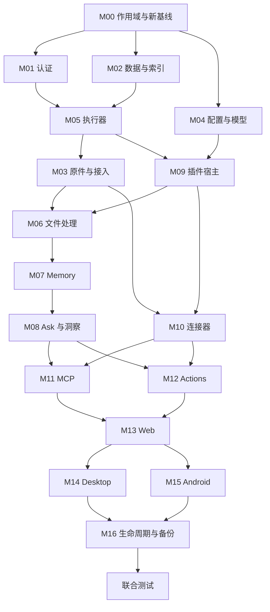

# Mote 多用户模块计划与验收合同

本计划以提交 `6272a9b51ec92cc4c32e2ff1a1eeb4fa38b142ed` 为发现基线，
固化规划对话
`<internal-task>` (internal discussion reference redacted)
的 17 个模块。决策与取代范围见 [多用户 ADR](../adr-multiuser-scope.md)。
以下矩阵是必须执行的验收要求，不是已通过的验证记录。M00 只交付作用域基础与
工程合同；M01–M16 均需各自实施、验收和提交。

## 目标与不可跨越的边界

采用最新推荐：少量受邀用户共用同一个部署，用户名密码，一账号一个私人资料库；
共享 SQLite、服务和单一执行器。管理员管理部署、账号与资源，不提供代看私人资料
API；部署者可接触服务器明文，不承诺端到端加密。用户可用管理员开放的共享模型
引用，也可配置个人模型。管理员安装可信插件包，用户独立启用和配置。首版支持
整实例备份恢复，个人导出明确覆盖范围，不承诺单用户历史时点恢复。

这些是当前实施请求采用的推荐组合，不能倒写成原讨论中用户已逐项拍板。
用户明确要求的同部署多用户、用户名密码、允许破坏式更新、强可拓展性与插件化
必须贯彻；允许破坏式更新不授权清空旧目录、操作真实数据或更新运行实例。

未完成隔离的私人能力保持不可用，不回退默认 owner，不临时给所有请求绑定同一个
用户。共享进程中的可信插件不是恶意代码沙箱；普通用户上传不能取得中央 shell
或任意宿主路径权限。新模块通过宿主注册能力接入，避免新增中央业务分派分支。

## 复用基础与真实缺口

| 已有基础 | 保留并扩展 | 尚需多用户改造 |
| --- | --- | --- |
| 统一客户端登录、票据与凭据撤销 | 复用交接、会话期限、代次检查、退出保留队列 | 当前 owner 凭据不能当作个人身份；设备/MCP 凭据绑定稳定账号。 |
| ConfigService | 复用 schema、revision、准备/同步发布、回滚和任务快照 | 拆实例/用户所有权；共享密钥以授权模型引用提供。 |
| ExecutionEngine | 复用租约、检查点、取消、提交 fence、故障分类、资源等待和 operation 公平性 | 持久化用户归属，准入与提交检查禁用/撤权，增加用户间公平性。 |
| Cordis、插件中心、来源/处理器/Memory/模型/UI 合同 | 复用固定 release、配置实例、能力核验、binding、暂停排空、独立审核和外部 journal | 包共享、实例归用户；替换 `mote-owner` 等固定 namespace；接入域生命周期。 |
| Memory 发布协调 | 保留每个私人空间的单一发布协调、精确版本和外部结果对账 | 将授权、provider namespace、策略、自动化和历史读取全部归用户。 |
| Web ResourceCache | 保留按 Api 实例缓存与旧响应发布 fence | 切换账号重建 Api，处理旧标签页、草稿、弹窗和提交。 |
| 客户端节点队列与 ACK 恢复 | 保留原字节和原任务身份恢复 | Desktop 的凭据哈希、Android 的 URL 不能替代稳定部署/账号绑定。 |

基线已包含插件一期、展示包、Linear 四目的地导航、飞书文档上下文和若干后台恢复
修复，不重复实现。历史的单所有者 fixture 和验证记录不证明多用户隔离。

## 作用域登记与 M00 接入点

M00 生产入口为 `scope/app.ts` 的 `buildScopedApp`，只开放 health 与拒绝兜底；
它不装配旧私人路由和后台运行时。M01 起使用 `registerUserRoute` 逐项接入。
`UserContextAuthority.authenticate` 经可信 verifier 签发不可变上下文，
`ScopedServices.forUser(context)` 要求同一宿主的有效上下文。
作用域代码位于 [`apps/server/src/scope`](../../apps/server/src/scope)。

| 登记对象 | 实例作用域 | 私人作用域及必须验证的边界 | 主要接入模块 |
| --- | --- | --- | --- |
| 表、唯一键、外键、FTS/向量索引 | 账号管理元数据、部署资源与可信包目录 | 来源、捕获、Material、文件引用、Memory、会话、授权、任务、用量、连接器；唯一键/关联/候选检索均不得跨用户 | M01、M02，后续各域补齐 |
| API、订阅、下载与工具 | health 和显式实例管理；管理身份不授予私人读取 | 缺身份、伪造身份、其他宿主上下文、跨用户 ID/游标/票据、撤权、迟到响应均受宿主检查 | M01–M13 |
| 任务、依赖与资源键 | 共享执行器、权重和明确的共享资源池 | 持久用户、输入/配置/授权快照、取消重试、恢复、检查点和提交 fence | M05，各任务所属模块 |
| 目录、临时文件和对象定位 | 可信包代码、共享权重及明确的实例配置 | 原件引用、临时工作目录、连接器状态、用户密钥、运行日志/产物、客户端队列；不能仅靠路径拼接声明隔离 | M03、M04、M06、M10、M14、M15 |
| 扩展、运行句柄与缓存 | 包定义、固定版本、受支持能力与安装 | 用户配置实例、授权、provider namespace、连接状态、订阅、运行时缓存和数据生命周期 | M07、M09–M12 |

作用域清单把既有单用户表/API/任务/目录/扩展标为隔离待办和 quarantine，而非
声明即合规。架构检查须拦截没有声明的新表、API、任务、目录或扩展；模块必须同时
登记所有权与实现状态，证明从生产入口可达时已有作用域检查。白名单不能成为绕过
隔离的默认路径。旧组合入口只存在于 `apps/server/test/fixtures/legacy-app.ts`，
由算法 fixture 显式导入且不能打开 epoch 5；生产构建不包含它。生产 `src/app.ts`
导出 scoped builder，启动和配置不能选中旧入口，不存在测试模式权限绕过。

合成双用户夹具位于 `apps/server/test/fixtures/two-users.ts`，基础验证位于
`apps/server/test/scope-foundation.test.ts`。后续模块复用夹具，使用相同外部 ID、
设备 ID、幂等键及文件字节制造冲突；不能靠预先分离所有输入避开跨用户负例。

## 新基线合同

| 合同 | M00 固化的多用户基线 | 实施责任 |
| --- | --- | --- |
| Central | epoch **5**；`scope_meta.epoch` 与 `user_version` 一致 | M00 写入前准入；M02 等接入各域新表。 |
| Wire | **2** | M00 声明新边界；M01 认证与 M13–M15 消费端推进。 |
| Ingress | **3** | M00 预定；M03 实现账号绑定、回执与协议验证。 |
| Portable archive | **3** | M00 预定；M16 实现范围、导入/导出和恢复。 |
| Desktop / Android local storage | 先保持 **3** | M14/M15 各自决定新账号绑定格式；旧账号未绑定队列不能开启或上传。 |

M00 不用旧 Ingress/portable 实现冒充新版本。未完成路径继续拒绝；常量不是能力
完成的证据。旧 Central 格式在 schema、WAL/journal、目录和后台任务任何写入之前
拒绝，文件集合与逐文件字节保持不变；不自动迁移、赋 owner 或清空目录。

## 模块改造与验收矩阵

依赖列列出直接前置；传递依赖同样有效。每个模块只交付自身边界，各域随本模块
提供生命周期实现，M16 负责编排。

| 模块 | 直接依赖 | 改造项与交付边界 | 可执行验收标准 |
| --- | --- | --- | --- |
| **M00 作用域基础与工程合同** | 无 | 宿主创建的不可变 UserContext、实例/用户服务入口；表/API/任务/目录/扩展登记；新存储/协议基线；域删除/导出/恢复合同；合成双用户夹具和架构检查；固化 ADR 与本计划。只建立可执行入口，不实现下游领域。 | 从真实生产入口验证缺身份、伪造身份和旧 owner token 拒绝私人操作；跨宿主/失效 context 拒绝；未声明作用域检查失败；旧格式在写前拒绝且目录与文件字节不变；基础服务与生命周期合同失败测试。 |
| **M01 账号、认证与权限** | M00 | 稳定用户 ID、用户名密码；管理员初始化/开户/禁用/重置；服务端 Web session；设备/MCP 凭据绑定用户；实例管理与私人权限拆分；明确密码尝试保护。 | 登录/退出/过期/撤销/改密/重置/禁用状态转换；Cookie/CSRF；普通用户拒绝管理 API；管理员不能凭管理权代看其他用户；旧全局 token 不进普通登录；登录保护不扩成业务额度。 |
| **M02 私人数据访问与索引** | M00 | 来源、捕获、Material、来源说明、版本/依赖、统计、FTS 用户归属；唯一键和关联约束；收口直接私人 SQL。 | A 访问 B 详情、计数、游标、修改/删除均拒绝且不泄露；相同外部 ID/版本各自存在；跨用户父子关联失败；FTS 候选在排序、重排与模型输入前隔离；失败事务不留部分关联。 |
| **M03 原件、采集、同步与导入接入** | M05 | 用户原件/临时目录、对象引用、pin/GC、下载播放票据；Ingress 3、设备/来源同步、Coding、上传批次与回执；普通上传与高级宿主导入权限分开。 | A/B 同 deviceId、外部 ID、幂等键和字节不覆盖或复用私人结果；归属由凭据决定；A 票据读不到 B；清理 A 不影响 B；普通上传不能触达 shell/任意宿主路径；过期/失败回执不产生串号重试。 |
| **M04 配置、模型与用量** | M00 | 复用 ConfigService 拆实例 YAML/用户配置；共享模型不可编辑引用；个人密钥隔离；模型选择、配置快照与用量归属。 | 页面/文件编辑同校验与冲突；A 改配置不改变 B 在途任务；用户不能改实例字段或资源权限；共享 key 不返回用户、不与用户改写 endpoint 组合；用量归各自账号；失败无静默模型回退。 |
| **M05 执行器、Operations 与公平调度** | M01、M02 | 一个执行器；任务、授权、依赖、资源键、恢复、取消、进度持久用户；按用户公平领取；准入/提交检查禁用。 | A 大量积压时 B 就绪任务无需等 A 全完成；重启和多 SQLite 连接保归属/并发；A 不能取消或重试 B；Web 退出不取消已授权后台任务；禁用后的迟到结果不能发布；外部结果未知不盲重放。 |
| **M06 OCR、ASR 与文件处理** | M03、M09 | 复用算法与共享权重；输入、配置、工作目录、缓存和提交目标来自用户任务上下文；处理器只用限定宿主接口。 | 双用户并发处理同字节不串缓存/产物；配置改变/取消后的迟到提交拒绝；重启复用本人合法 checkpoint；原件保存、处理与索引状态分开；失败不发布部分他人结果。 |
| **M07 Memory 与检索** | M06 | 提取、审核、整合、策略/自动化、checkpoint、binding、删除、provider namespace 全部归用户；保留精确版本和单一发布协调。 | 内置、Mem0/Hindsight 受支持模式分别测 A/B；候选、重排、模型上下文无 B 内容；暂停/排空/立即停止只影响本人；外部失败不静默读 SQL 旧正文；上传者与语义主体不混同；失效输入阻止迟到发布。 |
| **M08 Ask、洞察、对话与委派** | M07 | EvidenceReader、开场记忆、会话/压缩、子任务、引用和运行产物继承宿主用户；模型没有切换用户能力。 | 并发问答/洞察与重启保归属；A 不能恢复 B 会话或读其子任务产物；检查真实模型请求 fixture，输入不含 B 证据；引用仍要求本轮披露原文；已成功子任务重启不重复调用；取消/撤权拒绝迟到响应。 |
| **M09 插件宿主与生命周期** | M04、M05 | 管理员安装共享包；用户实例、配置、授权、句柄、订阅隔离；沿来源/处理器/Memory/模型/UI 合同提供用户能力；删除/导出/恢复责任。 | 用实际生成插件经正式注册证明无需新增中央业务分支；A/B 启用配置互不影响；停一个实例不卸载兄弟；固定版本任务/历史读取正确；普通用户不能加载代码；不把可信进程宣称沙箱；失败安装不激活实例。 |
| **M10 外部连接器** | M03、M09 | Gmail、日历、飞书、钉钉等共享定义+用户连接；凭据、CLI 配置、选择、游标、任务/定时器隔离；OAuth state 固定发起人。 | A/B 同时授权、回调倒序、浏览器换账号仍归正确用户；重启/断开/暂停只影响本人；不能复用他人凭据、CLI 身份和游标；安装不读历史；失败/重放 callback 不改变另一连接。 |
| **M11 MCP 输入与输出** | M08、M10 | 对外 token/session 固定用户和来源 scope；外部 MCP 配置、连接句柄、授权归用户；工具只得限定能力。 | A token 读不到 B；限定来源写入不能改其他来源；session 不随浏览器账号改变；撤销后请求与提交拒绝；本地高风险 MCP 执行遵守管理员边界；伪造工具 userId 不改变宿主用户。 |
| **M12 Actions、待办与日程执行** | M08、M10 | 建议、审批、审批设备、时区、外部账号/目标归用户；查询工具与写授权/执行分离。 | A 不能审批/修改/执行 B；交错审批与重启不串目标、不重复外部写；撤权/禁用 fence；Ask 不经隐藏写工具执行；结果未知对账而非盲目重放。 |
| **M13 Web 账号与管理体验** | M11、M12 | 用户名密码、当前账号、个人设置、管理员页；切换重建 Api、清除私人页面/订阅并绑定草稿；复用现有导航/展示包。 | 隐藏真实 renderer 测 A→B、旧标签页、慢响应、旧弹窗、在途提交；A 旧页面不能用 B session 误提交；UI 与后端权限一致；资源/配置/任务显示正确账号；失败登录不残留前用户内容。 |
| **M14 Desktop** | M13 | 一活跃账号/节点；安全凭据；队列/来源游标/草稿/浏览器交接绑定稳定部署和账号；退出切换暂停；确定本地格式门禁。 | 合成离线 A 队列→切 B→重启/迟到 ACK，A 字节不发给 B；重登 A 续传；同账号换凭据不变归属；显式开始 B 采集；旧无账号格式写前拒绝；本地隐私/授权保持。 |
| **M15 Android** | M13 | 个人凭据及稳定身份；WorkManager、文件任务、页面采集、随手记、来源/草稿和 Web/原生入口共用当前账号；确定本地格式门禁。 | JVM 与无窗口 emulator 测 A/B、进程死亡、WorkManager 重试、离线恢复和旧响应；旧队列不串号；原生中央/采集共用账号；旧无账号格式写前拒绝；真机后台/权限另报。 |
| **M16 删除、导出、备份与部署闭环** | M14、M15，全部域生命周期实现 | 编排禁用/删除；私人导出/导入及 portable 3；整实例离线备份恢复；诊断/更新/GC 权限；新基线操作文档。 | 删除 A 覆盖任务/凭据/外部索引/缓存，B 哈希和状态不变；外部清除未知不报擦除成功；A 导出不含 B/凭据；隔离实例恢复账号、原件、Memory、会话和恢复任务；旧目录不自动重置；缺域 hook 明确阻断。 |

## 域生命周期合同

`LifecycleAuthority` 由宿主验证持久操作授权，签发绑定 deployment/user/domain/operation/purpose 的不可变 `LifecycleContext`。`ScopedServices.forLifecycle` 仅运行该授权的生命周期动作，不暴露私人服务查询；因此禁用账号撤销普通 `UserContext` 后仍可继续幂等删除和外部清除对账。管理员身份本身不能铸造该授权。M16 实现授权持久化、审批和撤销检查。

每个私人域注册时必须提供 `exportUser`、`deleteUser`、`restoreUser`，
并声明域 ID、拥有的数据和外部资源、版本及负责模块。M00 定义注册和调用边界；
各模块实现自己的数据责任，M16 统一编排。不得把缺失 hook 默认为成功。

| 操作 | 各域实现必须遵守的合同 | 验收证据 |
| --- | --- | --- |
| Export | 仅导出调用上下文所属账号的规范资料，声明格式/覆盖范围/缺失项；不带其他用户内容、明文凭据或可复用登录授权；固定一致性边界并说明外部正文失败。 | A/B 相同业务 ID，解包逐项核对；外部失败时结果不假称完整；不能接受客户端 userId 选择导出对象。 |
| Delete | 先撤销准入与发布权，再处理本域依赖、任务、缓存、文件引用及外部资源；重试幂等；逻辑不可见、待对账和物理擦除分别记录；共享资源按引用保留。 | 删除过程中有运行和迟到任务；A 不可再读/发布，B 的字节及状态不变；外部未知只观察/清除，不重新写回。 |
| Restore | 先校验格式、域覆盖和宿主绑定，再恢复到获准目标；身份映射由宿主决定，资料中的 userId 不授予权限；恢复任务保留原意图与 fence；拒绝不支持的域或版本。 | 损坏/缺域/错误目标失败前无越权发布；重复恢复不重复外部动作；恢复后任务和 provider namespace 只属正确账号。 |

域 hook 的存在不是个人时点恢复的承诺；首版恢复单位仍是整实例。插件卸载不等于
删除资料，禁用账号不等于物理擦除。管理编排可以定位目标账号并调用受限生命周期
合同，但不能把管理权转换为任意私人查询或会话冒充权限。

## 依赖图与调度顺序

图中省略传递依赖；所有模块均继承 M00 合同和 fail-closed 要求。

实施顺序固定为：M00；M01/M02；M04/M05；M03/M09；M06/M10；M07；
M08；M11/M12；M13；M14/M15；M16；联合测试。每个大模块单独对话实施和验收，
父对话调度，总计保持 2–3 个活跃对话，不预先启动所有模块。依赖完成后才补位；
M13 可以提前研究现有账号页视觉模式，完整验收仍等待领域合同。

## 分支、PR 与证据要求

集成分支为 `codex/mote-multiuser-integration`，以发现基线提交建立；模块分支如
`codex/mote-multiuser-m00-scope` 从已含其前置成果的集成分支建立独立 worktree。
已有同名分支先核对，不能覆盖。主工作区未跟踪文件不触碰。每模块只向集成分支
提交独立 Draft PR，不提交或合并 `main`；不部署、不更新运行实例、不操作真实数据。
父对话负责调度和后续集成。

每个模块完成后：

1. 用生产接入点和实际启动/停止/恢复顺序验证该模块旅程，补跨用户拒绝与失败路径。
   明确列出本模块恢复的真实生产 API、worker、插件或客户端入口及其验收证据。
   算法 fixture、手工组装内部对象或旧单用户测试不能替代作用域验收。
2. 运行适用检查，以及仓库要求的
   `npm run check:affected -- --base origin/codex/mote-multiuser-integration`。
   共享协议变化检查消费者；原生/renderer/emulator、模型和外部服务按实际影响补测。
3. 对重要边界作独立审查并解决高优先级问题。过时单用户测试可以更新为新基线意图，
   不能广泛跳过或伪造 context 取得绿色结果。
4. 核对提交已在远端模块分支、Draft PR 的精确 head/base、该 head 的 CI 状态。
   仓库 Checks/Component checks 是否启用需如实报告；本计划不授权改变仓库设置。
5. 记录实现与验证的精确提交、测试命令/结果、失败或未运行原因、独立审查结论、
   PR 链接、剩余限制及下一模块接入说明。通过、失败、未运行分别列明；历史记录
   和其他提交的 CI 不能替代本提交证据。

检查范围规则见 [开发指南](../development.md#pr-check-scope)。文档本身不把
未来测试要求算作已执行通过。

公共机制复审与推广顺序见 [公共合同与迁移规范](multiuser-public-contracts.md)，
三条代表链、共享 fixture 边界、旧能力映射及精确复审证据见
[共享测试清单](../validation/multiuser-public-contracts.md)。这些记录补充接缝验收，
不替代各模块及最终同一组合的必需检查。

## 联合验收矩阵

联合测试在全部模块集成后的同一个精确提交执行，复用生成的双用户资料，通过完整
真实生产组合覆盖恢复的全部能力。只启动 M00 health/拒绝空壳、导入旧测试组合或
手工拼装领域内部对象均不能算联合通过。完整 TypeScript 集成与 Android 单测之外，
还覆盖适用的真实 renderer、无窗口 emulator 及原生构建。真机、真实模型、真实外部
服务和部署检查单独列出，不能由 fixture 结果代替。

| 联合旅程 | 必须组合的状态/负例 | 成功证据 |
| --- | --- | --- |
| 采集 → 处理 → Material → Memory → Ask | A/B 同外部身份、设备 ID、幂等键、文件字节；并发与重启 | 每一阶段的存储、模型输入、引用与答案均只含本人资料；另一用户状态不变。 |
| 私人读取与变更 | 详情、统计、分页、下载/播放、进度订阅、MCP、导出、审批中交换 ID/游标/token | 读取和写入均拒绝跨用户，错误与计数不泄露存在性；审计归属正确。 |
| 配置、权限与迟到结果 | A 改配置，B 正运行；退出/切换、撤权/禁用、取消和模型迟到输出交错 | 不串配置，不扩大历史授权；失去发布权的结果被 fence；已授权正常后台任务不因 Web 退出误取消。 |
| 调度与恢复 | A 大量积压、B 小量；多 SQLite 连接、服务重启、子任务完成/检查点、失败与结果未知 | 用户间公平；不超共享并发；不重复成功模型子任务或未知外部写；各任务保持原归属。 |
| 插件与连接器 | 包安装、A/B 实例启停、固定版本、OAuth 倒序/重复回调、浏览器换账号、断开/重启 | 安装不等于启用或读历史；兄弟实例/凭据/游标互不影响；历史读取和恢复用原绑定。 |
| Desktop / Android 队列 | A 离线队列，切 B，进程结束、WorkManager 重试、旧 ACK、重登 A、同账号凭据轮换 | A 字节始终只发 A；B 明确开始自己的采集；轮换不改变稳定归属；旧格式写前拒绝。 |
| 用户删除与导出 | A 有运行任务、外部 pending erase、共享对象；B 正常使用 | A 立即失去读/发布权；外部未知如实报告；B 数据哈希/状态不变；导出无 B 内容或凭据。 |
| 备份/恢复与格式拒绝 | 隔离实例整库离线恢复；账号、原件、Memory、会话、未完成任务；旧格式及损坏/缺域输入 | 恢复后身份与任务归属正确；失败不发布部分越权结果；旧目录文件集合与字节不变，无自动 reset。 |

联合失败应落到责任模块形成回归，并重跑受影响组合；只有所有必需检查有对应结果、
剩余未验证项有明确说明，才能向父对话报告整体交付状态。
