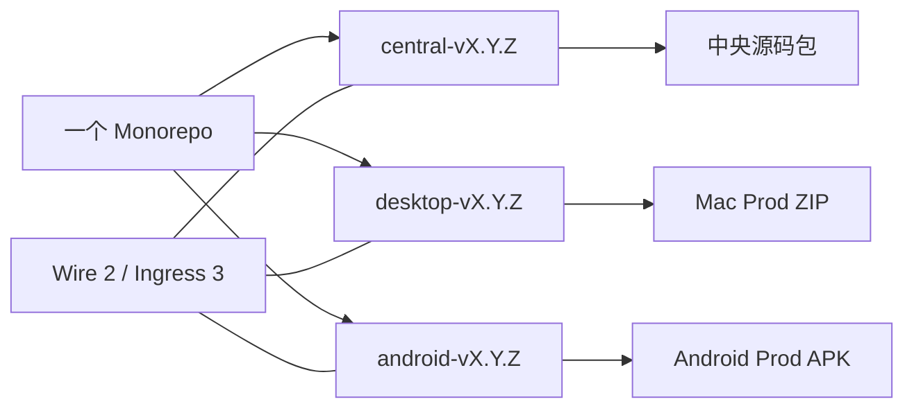

# Monorepo 内独立发布

2026-10-01 建立独立发布边界；2026-10-18 更新多用户基线。源码继续保留在一个 npm Monorepo，版本对应用户实际独立升级的产品。一次协议修改仍能在同一个 PR 中原子调整所有端，但每个发布标签只构建和分发一个产品。

| 发布边界 | 内容 | 何时发版 |
| --- | --- | --- |
| Central | server、web、编入该部署的 agent runtime 与中央插件 | 中央行为、网页或部署依赖变化 |
| Desktop | Electron collector、原生助手和本地依赖 | macOS 客户端需要升级 |
| Android | Kotlin collector、原生库和打包资源 | Android 客户端需要升级 |
| Protocol | 跨平台传输契约及生成 fixture | 契约变化，验证受影响产品 |

Central 的网页由中央部署提供，保留 server/web 的同版本构建检查。桌面与 Android 按各自版本独立升级；能否连接由当前协议契约决定，不能以三者产品版本相同作为兼容条件。根 package.json 没有产品版本，共享内部 workspace 包保持私有，构建时由产品带入对应提交的实现。

协议范围由 [protocol/contract.json](../protocol/contract.json) 声明，当前为 `{min:2,max:2}`，Ingress 为 3。Central 的公开健康接口声明协议范围与部署可用状态；客户端在连接自检时校验协议，缺失或错误的元数据会拒绝连接。健康检查不授予用户权限；账号、凭据与已授权来源决定实际访问范围。任何资料内容都不能改变客户端、Agent 或发布器的权限。

当前只接受声明的 Wire 2 / Ingress 3 契约。多用户中央存储为 epoch 5，Desktop 与 Android 本机格式为 4，账号便携归档为 `mote-portable` version 3。MVP 不提供旧库、旧 owner token、Wire 1 或旧便携归档的自动迁移与兼容入口；旧 owner token 不能替代账号登录。跨代更新须保留旧程序与完整备份，为当前版本选择新空 profile 或资料目录，再初始化管理员并登录。已在当前代际内的配置、账号和正常持久状态按现有生命周期保留；个人归档导入仍须属于同一部署和账号，不能把旧归档改写版本号后导入。具体步骤见[更新说明](updating.md)。

破坏契约的修改应同步调整受影响消费者与 fixture。平台 feature inventory 与来源 capability registry 继续描述实际安装能力；产品版本号不能用来猜测设备能做什么。TS、Kotlin 与连接链路共用生成的协议 fixture，真机和真实模型验证另行记录。

三个工作流分别匹配三个标签前缀。版本脚本只递增选中的产品；Android versionCode 仅随 Android 升级单调递增。检查器根据 workspace 依赖图和非 npm 构建输入选择范围：共享协议检查全部端，中央插件只检查 Central。根配置、lockfile 或未知构建输入采取保守的全消费者检查。各端发布 workflow 只构建对应组件并验证版本、签名与附件；Beta / 正式标签始终执行组件测试；`MOTE_PRE_RELEASE_CHECKS` 仅控制 Dev 可选测试，当前暂停策略见[发布流程](releasing.md#mvp-阶段的-github-检查开关)。纯文档（含 AGENTS.md 和各语言 README）不触发应用构建。本地 `npm run check:affected` 与启用后的 CI 共用选择规则，额外用户流程验证见[开发指南](development.md#pr-check-scope)。测试范围和发布范围分开，检查通过不会替任何端自动发版。

历史统一标签仍可作为发布记录阅读。当前更新器只读取所属组件标签和明确声明组件的签名清单，拒绝统一旧流及缺失组件。当前发布不附签名更新清单，仍由用户手动安装；Dev 仅作为按提交标识的 Actions Artifact，Beta / 正式 Tag 构建 Prod 包。签名验证与安装身份校验是当前功能，不能用旧清单兜底。

中央源码发布包含构建所需工作区及锁文件，在独立目录安装依赖、构建 server/web。同代更新沿用现有 profile 的备份、切换和回退流程；跨代不直接复用不兼容的资料库。它不把用户配置、密钥、模型权重或归档数据编入产物，不创建新的镜像发布通道。

未来 iOS 或新硬件实现只需新增产品组、安装身份和对应平台的协议测试。中央插件沿用现有 manifest、权限与宿主 capability 契约，在可独立加载升级之前仍随 Central 构建；本次不引入插件市场或承诺插件热更新。外部社区设备、SDK 或插件有独立维护与授权需求时，再考虑单独仓库。

Profile、调试默认项与 Dev 文件凭据的责任边界见 [Profile 与发版 ADR](adr-profile-release-policy.md)。实际操作见 [发布流程](releasing.md)，保留本地配置的升级步骤见 [更新说明](updating.md)。
