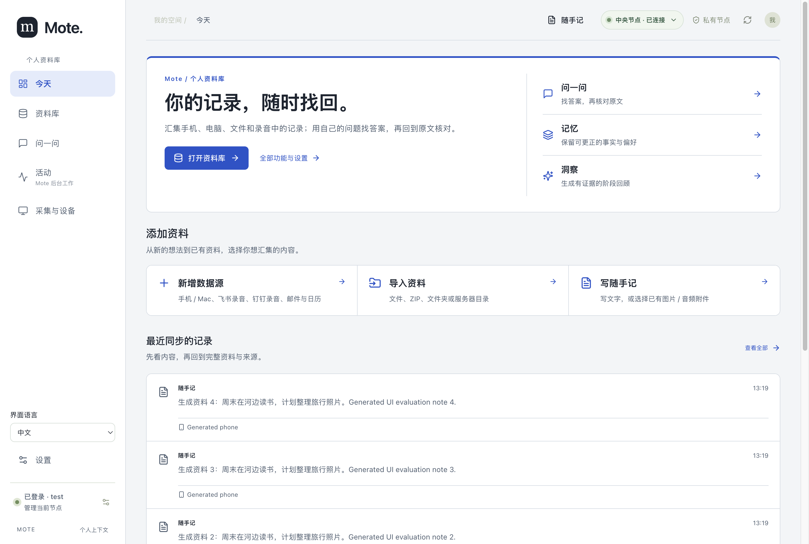
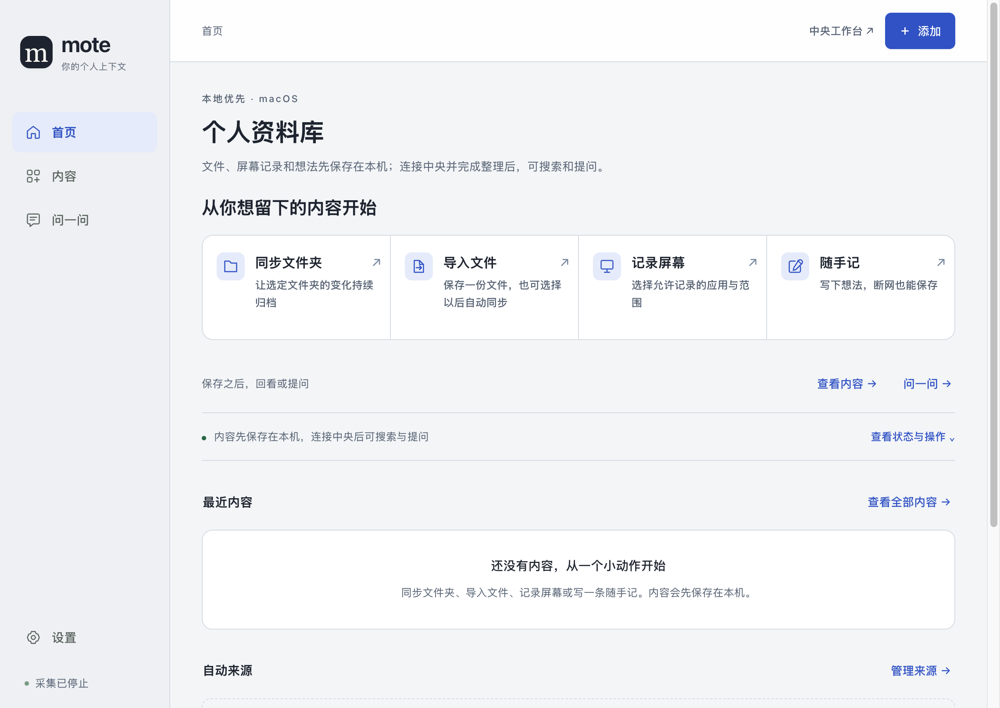
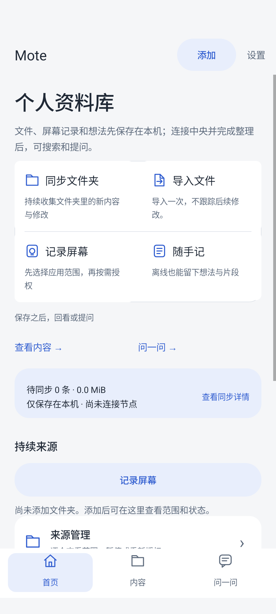

# 三端 UI 五轮迭代验证（2026-10-13）

本次在本地分支 `codex/ui-five-rounds` 上完成 Web、Mac、Android 的五轮实现与独立评估。没有发布或部署。方法合同见 [迭代记录](../design/ui-iterations-2026-10-13.md)，完整逐轮评分和实际操作见 [独立评估](../design/ui-iteration-evaluator-2026-10-13.md)，功能清单与测试边界见 [旅程清单](../design/ui-iteration-journeys-2026-10-13.md)。

## 实现结果

- 首页说明 Mote 是个人资料库，解释保存、整理、找回与提问的关系；原生保留四个平等动作和本机优先行为。
- Web 合并重复入口，最近记录采用可阅读的紧凑列表，四条记录在窄屏均保留；问答、记忆、洞察与全部功能入口可发现。
- Web 全部功能目录保留 16 组、78 项能力，四类用途索引支持键盘焦点；Mac 打开该目录，Android 明确列出本客户端已有能力。
- 折叠后台细节时仍展示实际状态和错误；修正离线问答、无凭据目的地说明、菜单重建、旧 Coding 传输类型及笔记详情文案。
- 中英文目录同步；未改变采集授权、发送、处理、原件保留或隐私策略。

## 独立设计评估

沿用原文的 Design quality、Originality、Craft、Functionality，追加第一眼理解与重要功能可发现性。0–10 尺度和 7 / 7 / 7 / 8 / 8 校准目标属于本项目，并非原文提供的数值或权重。实现者与评估者分开，真实操作和截图检查后形成下一轮反馈；最终依据反馈选择第 5 轮。

| 平台 | Design quality | Originality | Craft | Functionality | 新增：理解与可发现性 |
| --- | ---: | ---: | ---: | ---: | ---: |
| Web | 8 | 7.5 | 8.5 | 8.5 | 8.5 |
| Mac | 8 | 6.5 | 8.5 | 8.5 | 8.5 |
| Android | 8 | 6.5 | 8.5 | 8.5 | 8.5 |

原生原创性仍低于本项目目标 7。英文 Web 在 320 px 的添加资料组位于首屏下方，顶部随手记、空库导入和全部功能入口仍可达。首轮原生独立操作证据不完整，历史记录保留为未验证。评分是独立模型判断，不能当成真实新用户的理解速度实验。

## 已执行验证

| 验证 | 结果与范围 |
| --- | --- |
| `npm run check:affected` | 最终复跑退出 0，包含 `check:local` 和 Android Debug JVM 单测。首次执行发现原有文件恢复测试对瞬时队列状态的时序假设；已以真实处理器屏障和有界完成等待修正测试，生产调度器未修改。 |
| `npm run check:i18n` | 8136 条中英文文案及 Android 英文目录同步通过。 |
| Web 五轮真实 renderer fixture | 基线、1、2 轮各 27 张截图 / 12 项操作；3、4 轮各 28 / 17；最终新增语言切换检查后为 38 / 24。共同核心保持，发现的回归逐轮加入。 |
| 最终 Web UI 旅程 | 隔离真实 Central、真实登录表单、生成笔记入库和原文阅读、主要入口、四类键盘跳转通过；中英文 1440 / 820 / 390 / 320 px 与英文 200% 缩放无横向溢出，四条最近记录均显示。 |
| 语言切换 | 实际 React 选择器：取消保持语言与路由；继续触发实际重载并保持生成登录状态。确认选择由 fixture 模拟；未验证系统原生确认框。 |
| 既有 Web 导航与配置 fixture | `scripts/test-web-navigation.cjs` 通过，保留配置、模型设置、草稿、来源、诊断与历史导航断言；更新了旧测试中的过时页面标签。 |
| 记忆执行队列 | 2 项实际挂载 React 测试通过：六条独立队列、折叠状态的错误、失败时隐藏旧数量及恢复；可选队列不凭空出现。 |
| Mac | 隔离真实 Electron UI smoke 通过，包含 820 × 620、离线笔记保存及阅读、来源、键盘、状态和认证刷新；9 项固定中央入口交接回归通过。链接对比度复查为 5.33。 |
| Android | 最终 APK 的扩展 UI fixture 2 项通过；真实合成中央界面 11 项通过、1 项设置专用 fixture 跳过；常规导航 instrumentation 8 项通过、2 项需单独启用的绘图 / 键盘测试跳过；4 项导航和 2 项媒体提示 JVM 测试通过。扩展 UI fixture 覆盖 320 dp、130% 字体、中英文、实际软键盘和 Activity 重建。 |
| 文件恢复时序回归 | 修正测试对合法异步进度的假设后，两个修改文件 21 / 21 通过，四个恢复与处理消费者并行检查 80 / 80 通过。仍验证原始不可变字节、单份版本、丢失 ACK 的幂等性与处理完成后的输入清理。 |

最终 `check:local` 完成共享库构建、三端消费者类型检查和全量 npm 测试：Desktop 436、Server 1543（另 1 项跳过）、Web 355、Agent 271（另 1 项跳过）、Diagnostics 5、Shared 179 项通过；根发布 / 安全 / 网络代理等检查 65 项、客户端 4 项和中央 runner 验证通过。Android Debug JVM 的 66 个套件、312 项测试通过，0 失败、0 跳过。全程无失败。最终日志为 `.mote/ui-iterations/check-affected-final.log`；首次失败日志保留，不能当成最终结果。

UI 测试均在后台执行：Web 和 Mac 窗口隐藏并禁止 fixture 显示、聚焦或启动外部浏览器，Android 使用专用无窗口 API 37 模拟器。全部内容、凭据和响应为生成 fixture；不读取个人屏幕、不授予采集权限、不调用真实模型。Android 图像来自应用自身 `View.draw(Canvas)`，产品 `FLAG_SECURE` 保持启用。

执行日志保留于忽略目录 `.mote/ui-iterations/`、`.mote/web-navigation/` 与 `/tmp/mote-native-ui/round-5/`。它们不是发布产物；认证临时文件由 fixture 清理，不提交凭据。

最终 UI fixture 的隐藏窗口、临时 Central、调试端口与本次新建无窗口 AVD 已清理；已有设备和 AVD 未改动。最终生产 UI diff 另经只读复核，未发现可行动的新问题；该复核不代替上述实际运行验证。

## 未验证范围

没有进行物理设备、真实模型、外部账号接入或真实新用户第一眼理解测试。能力目录和入口可达检查不等于完整执行全部 78 项功能。原生不同于 Web 的能力边界继续保留。测试中的确认框选择和屏幕采集 IPC 使用 fixture，不能据此声称系统权限和真实采集通过。

## 合成界面预览

以下图像仅含生成资料，不含个人数据；从最终 fixture 原样复制。

### Web

### Mac

### Android

