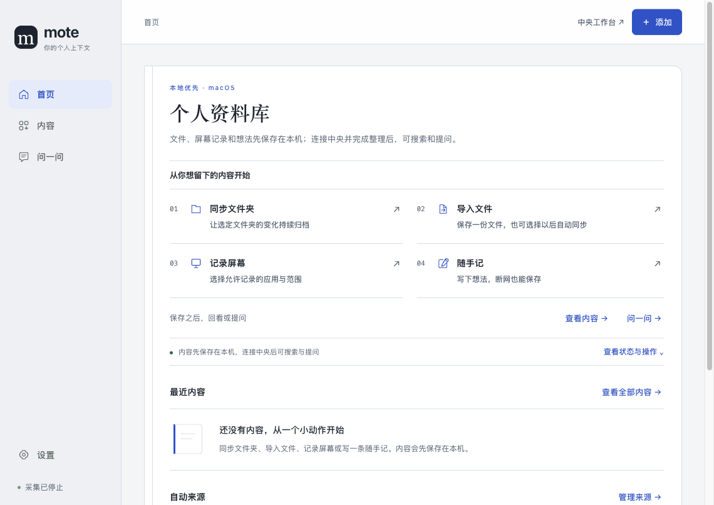
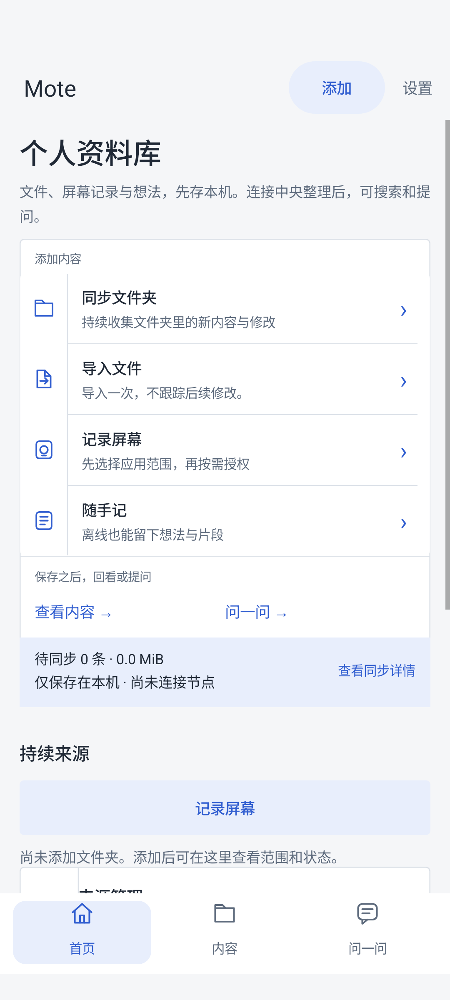
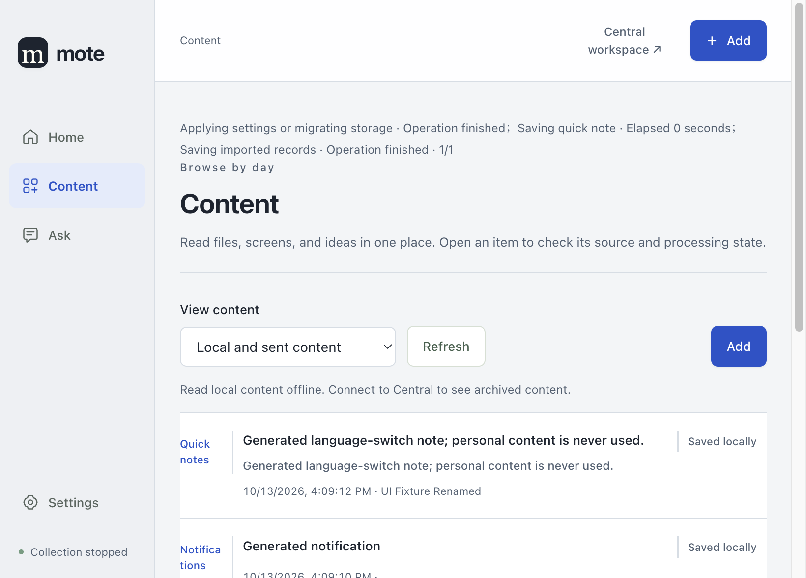

# 原生原创性续迭代与离线 HTML 验证（2026-10-13）

本次承接原对话的五轮提交 `7e94ea3` 与未提交续迭代，在当前分支 `codex/ui-continuation` 延续。五轮已移植为 `4fd1637b`；分支仍包含其原基线中更新的说话人显示修复。没有部署或发布。用户要求 Mac、Android Originality 严格超过 7，其他四项不得下降，UI 测试在后台；“解耦”已确认指独立离线 HTML。范围见 [续迭代合同](../design/ui-originality-2026-10-13.md)。

## 最终 UI 结果

沿用 Design quality、Originality、Craft、Functionality，加上首次理解与重要功能可发现性；固定 0–10 尺度与锚点、实现者和评估者分开、实际操作与截图复评。没有增加总分或改变标准。历史候选与本次独立操作见 [独立续评](../design/ui-originality-evaluator-2026-10-13.md)。

| 平台与方案 | Design quality | Originality | Craft | Functionality | 理解与可发现性 |
| --- | ---: | ---: | ---: | ---: | ---: |
| Web，第 5 轮设计保持 | 8 | 7.5 | 8.5 | 8.5 | 8.5 |
| Mac，第 5 轮参照 | 8 | 6.5 | 8.5 | 8.5 | 8.5 |
| Mac，当前 D2 | 8.5 | 7.5 | 8.5 | 8.5 | 8.5 |
| Android，第 5 轮参照 | 8 | 6.5 | 8.5 | 8.5 | 8.5 |
| Android，当前 R8 | 8 | 7.5 | 8.5 | 8.5 | 8.5 |

两端 Originality >7，其他四项不下降。评分属于独立模型的设计判断，不是真人首次使用实验。原 D / R6 / R7 的实际记录保留为历史，不能替代当前构建检查。

## 实现与已处理缺口

- Home、添加、内容列表、随手记和原文阅读共用资料页层级与来源边栏；保留三个主目的地、四个平等动作、离线保存、权限、发送和处理边界。
- Mac 修复英文类型和长来源名换行、原文关闭动作翻译；当前 D2 另修正切语言后缓存中文后台操作标签的问题，运行中、完成与失败状态都按当前语言显示。
- Android 首页显式读取已有本机全部来源，包含已保存笔记。旧 R6 断言误读隐藏 Content 页，相关已有内容首页证明作废；新断言限定可见 Home 子树，验证精确记录 ID、正文、完整可见行和同一原文。
- 当前 Android 英文 320 dp / 130% 字体重跑发现第四个动作裁切 23 px。动作行纵向内边距从 8 改为 6 dp，保留字号、文案和 64 dp 最小高度；全矩阵重新通过才接受 R8。失败 APK 与截图留在忽略的证据目录。
- 离线 HTML 原来的部分报告链接和旧轮次图片不随包携带；现同步本地文档与图片，并验证全部报告本地引用。历史临时目录已清理，生成器用冻结 manifest 与 PNG SHA-256 保留旧证据，刷新当前平台时删除其全部旧候选场景，不以旧图补缺项。
- 41 次持久化导入测试只增加局部 45 秒有界超时，保留 41 条记录与原断言；没有改 SourceManager、全局超时或产品 SLA。

## 当前目录实际执行

| 检查 | 实际范围与结果 |
| --- | --- |
| `npm run check:affected` | 首次完整执行与最终 Android 布局修正后复跑均退出 0，含三端消费者与 Debug JVM。最终日志为 `.mote/ui-continuation/check-affected-final.log`。 |
| Web 构建与 UI | `npm run build:central` 成功。当前真实 Central / renderer fixture：38 张生成截图、24 条交互旅程，中英文 1440 / 820 / 390 / 320 px、英文 200% 缩放、登录、笔记接收、原文、键盘目录和实际语言切换通过；16 组 / 78 功能单元保留。 |
| Web 消费者导航 | `test-web-navigation.cjs` 通过：历史导航、键盘阅读返回、配置草稿、来源、模型设置、同步与诊断、桌面 / 手机布局。 |
| Mac 构建与完整 UI | Desktop 完整构建成功，包含 native helper / updater；隐藏 Electron UI smoke 退出 0。真实生成通知、笔记、文件的混合来源、126 字符无空格来源名、英文 820 × 620 原文阅读与关闭、草稿、配置、分页、迁移失败和权限桩通过。后台单元文件 5 项通过（含新增语言回归），并在切到英文后实际保存笔记验证状态标签。 |
| Mac 四条件与独立操作 | 中英文 × 1140 × 808 / 820 × 620 共 28 张当前场景，无页面横向溢出。独立评审另自行执行英文切换 → 唯一新笔记 → Home → 同一原文 → Close details → 同一行焦点 → 离线 Ask；本机保存不要求中央连接。 |
| Android 构建与四条件 | Development App / test APK 构建成功；最终产品 APK SHA-256 `025178385afa56cb98a63daa382319bdc87e9c6588d4ac452dde530cbe37b793`。API 37 专用无窗口模拟器：中英文常规 1080 × 2400 / 420 dpi，及中英文 320 dp / 540 dpi / 130% 字体，每组 3 项，合计 12 通过、0 跳过。窄屏使用真实 IME，四个完整动作均在首页首屏。 |
| Android 回读与独立操作 | 矩阵精确验证可见 Home 的记录 ID / 正文与原文；独立评审另通过真实编辑器 / IME 输入新笔记，不访问 Content，直接 Home → 滚动到同一可见记录 → 精确原文 → Close details → 同一首页。 |
| Android 导航与 JVM | 核心导航 8 项通过、2 项需单独启用的绘图 / 键盘检查明确跳过。Development JVM 在本次首轮构建中 66 套件 / 312 项通过，早于最后的 6 dp 布局修正；最终源码的 Debug JVM 66 套件 / 312 项通过，0 失败、0 错误、0 跳过。最终复跑复用相同有效输入的 Gradle 成功结果。 |
| 翻译 | 标准入口检查中英文目录与 Android 英文同步；当前新增用途说明与原文动作译文均保留。 |
| 离线 HTML / ZIP | 最终双端刷新后 147 PNG / 164 个打包文件通过隐藏 `file://` 验证与 ZIP 解压迁移：16 平台 / 语言 / 条件组合及全部静态场景、6 报告图片、34 本地文档链接、非空本地备注重载、放大 / Escape、宽窄布局、零外部请求；损坏冻结输入被拒绝。74 个 baseline 资产元数据完整保留，73 个 candidate 全部来自当前构建。报告最终文字更新后再次检查文档链接、PNG 与包内字节。 |

最终完整受影响检查包含 Desktop 437、Server 1544（另 1 跳过）、Web 359、Agent 271（另 1 跳过）、Diagnostics 5、Shared 179 项通过；根发布 / 安全 / 网络代理等 65 项、客户端 4 项与中央 runner 通过，Android Debug JVM 312 项通过。全程没有失败，明确的跳过仍单列；没有把失败候选或中断当成通过。

UI 测试全部后台执行。Web / Mac 使用隐藏 Electron 窗口；Android 使用本次创建的无窗口 API 37 AVD，图像仅由应用自身 `View.draw(Canvas)` 产生，产品 `FLAG_SECURE` 保留。资料、名称、通知、文件、凭据和回答均为生成 fixture。没有读取个人屏幕或通知，也没有实际启动采集。

独立 Mac 第一次语言探针停在既有确认框，原因是先前重载移除了测试桩；重启生成环境并显式模拟确认后，真实语言处理器与重载通过。这个探针不证明页面卡死，系统原生确认框也不在本次验证范围。

本次隐藏 UI 窗口、临时 Central 与 Mac 生成 profile 已释放；仅本次新建 Android 无窗口 AVD 已删除。未触及其他设备或 AVD，验证截图与日志保留。

## 离线交付

入口为忽略目录 `.mote/ui-review-2026-10-13/index.html`；可直接离线打开或将 `.mote/ui-review-2026-10-13.zip` 解压到任意目录。无需后端、登录、依赖安装或设备权限。模板和重建方式见 [展示说明](../design/ui-review-2026-10-13/README.md)。

可切换 Web / Mac / Android、语言、尺寸、场景、原图放大及第 5 轮 / 当前对照。截图中的产品按钮不执行保存、上传或提问；倾向与备注仅存浏览器本地，可导出文字。缺少旧英文或当前未捕获的场景明确显示缺项，不用其他图替代。当前双端候选只采用本次构建的图，第 5 轮保持冻结来源与哈希。大量 PNG 和 ZIP 不提交到源码仓库。

## 验证边界

没有执行物理设备、真实采集、真实模型、外部账号、原生系统权限对话框、完整无障碍或真人首次理解实验。功能目录和入口可达不等于执行全部 78 项功能。当前分支检查与旧轮次分开记录，也不代表改动已合并或发布。

## 当前生成预览

